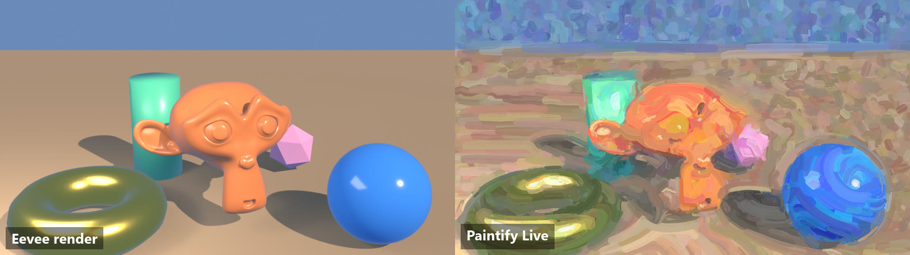
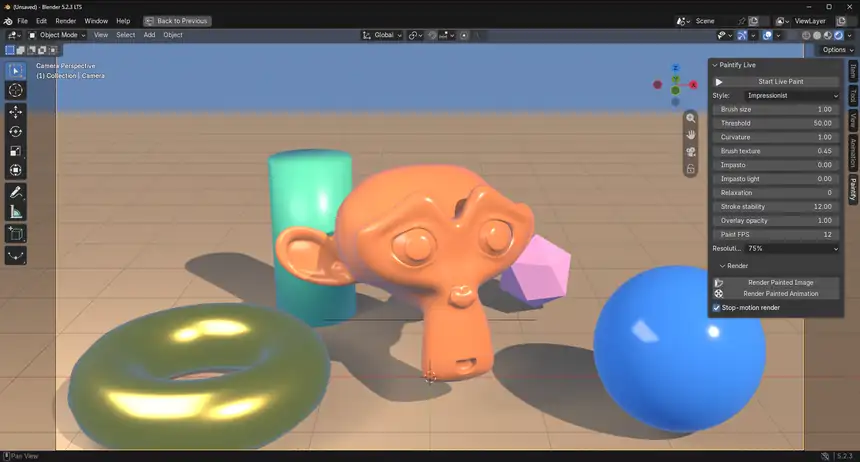
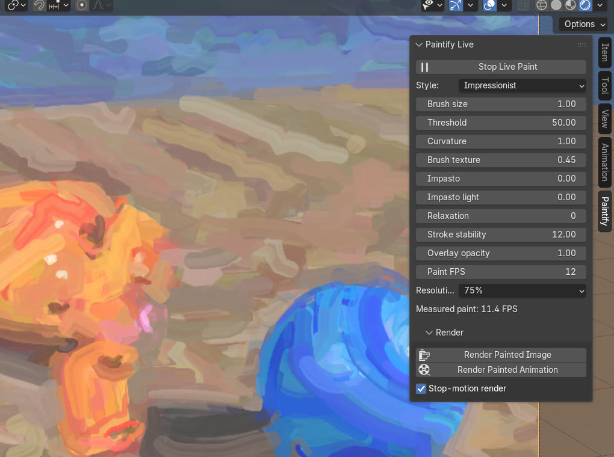
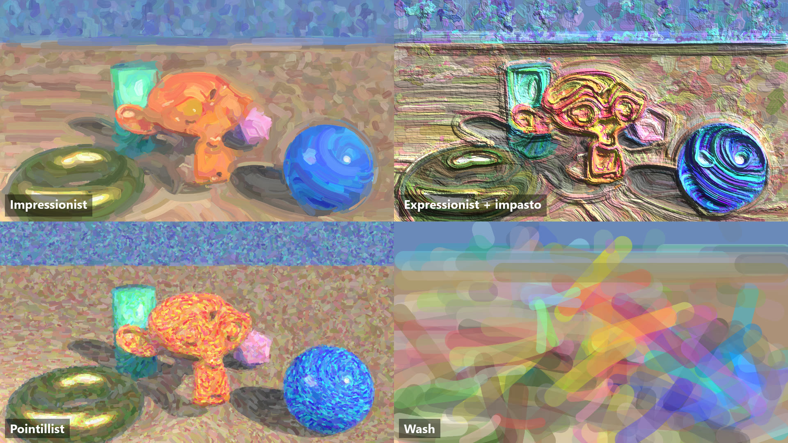
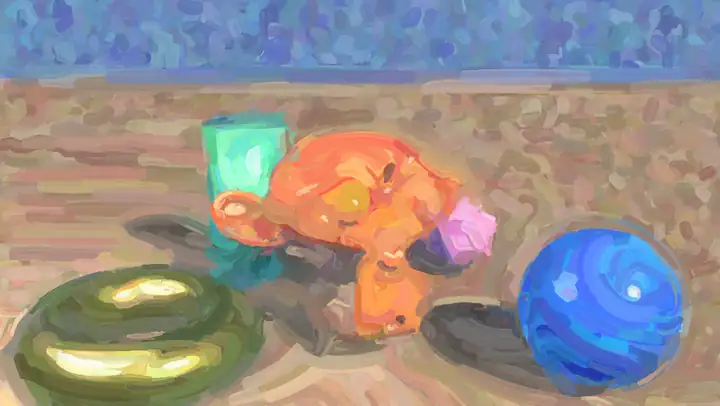

# Paintify Live for Blender

Paintify Live paints **whatever the active 3D Viewport shows** as a live
overlay, and paints **final renders** (stills, image sequences and movies) the
same way. It uses the GPU Hertzmann stroke pipeline from
[paintify-GPU](https://github.com/BrownBearr/paintify-GPU): curved brush
strokes, relaxation, brush texture and impasto.

The painter runs on Blender's own `gpu` module, so Blender compiles it for
whatever backend it uses: Metal on macOS, Vulkan or OpenGL on Windows and
Linux. There is nothing to build and no external program.

  

   
  <a href="docs/media/live-viewport.mp4"><b>▶ Full-resolution clip</b></a>: Start Live Paint, then switch styles during playback.

## Install (Blender 4.2 or newer)

Download the zip for your platform from `dist/` (open the file on GitHub, then
**Download raw file**):

- macOS: [`dist/paintify_live_mac.zip`](dist/paintify_live_mac.zip)
- Windows: [`dist/paintify_live_windows.zip`](dist/paintify_live_windows.zip)

Both zips contain the same files; either works on Linux too. Don't unzip it.
In Blender, choose **Edit > Preferences > Add-ons > Install from Disk**, pick
the zip, and enable **Paintify Live**. Preferences should show version 0.3.1.

Installing replaces an older Paintify Live in place. If Blender still reports
`paintify-stream.exe`, an old 0.2.x copy is loaded: uninstall every Paintify
entry in Add-ons, remove any Script Directory that points at a checkout of this
repository, restart Blender and install again.

## Viewport

Open a **3D Viewport**, press **N** for the sidebar, and open **Paintify**.
Click **Start Live Paint**. Adjust style, brush size, curvature, threshold,
brush texture, impasto, relaxation and opacity while looking at the viewport.
**Paint FPS** sets the stop-motion cadence and **Resolution** trades preview
detail for speed. The panel shows the measured paint rate.

  

Four of the five styles, painting the same frame:

  

In **camera view** the overlay paints exactly the camera frame, through the
camera's projection at the render's aspect. That is the preview of the
render. Outside camera view it paints the whole viewport.

## Render

In the **Render** subpanel (also at the bottom of Blender's **Render** menu):

- **Render Painted Image** renders the current frame with the scene's engine,
  paints it and opens it as the **Paintify Render** image. Save it from the
  Image Editor.
- **Render Painted Animation** renders the frame range and writes the scene's
  output: an image sequence at the output path, or a movie through Blender's
  own encoder when the output is a video format. Esc cancels.

Renders paint at full render resolution. Brush sizes scale with the frame, so
a 50% viewport preview and a 4K render get the same strokes relative to the
frame. The source is the render as the scene's colour management displays it,
the same image the overlay samples in the viewport. With **Stop-motion
render** on (default), each painted frame is held for scene FPS / Paint FPS
frames, as the viewport shows during playback. Turn it off to paint every
frame. Temporal stroke stability carries over from frame to frame as in the
viewport.

   
  Render Painted Animation, 12 paint FPS on a 24 FPS scene. <a href="docs/media/turntable.mp4"><b>▶ Side-by-side with the plain Eevee render</b></a>

For the closest match between overlay and render, preview in camera view with
**Rendered** shading. Solid and Material Preview shading paint what those
modes show, which differs from the final engine. Movies do not carry the
scene's audio.

## Develop

This repository contains only the add-on (`blender_addon/paintify_gpu/`), its
tests and the packaging tool. See `CLAUDE.md` for the rules.

- `python tools/package_addon.py` rebuilds both zips in `dist/`. Commit them
  with any add-on change; `tests/test_dist.py` fails when they are stale.
- `python -m unittest discover -s tests -p "test_*.py"` runs the tests that
  don't need Blender. The shader test compiles every stage as strict Vulkan
  GLSL when `glslangValidator` is installed (`brew install glslang`).
- `blender --background --factory-startup --python tests/blender_smoke.py`
  paints, drives the overlay and renders a still, a PNG sequence and an MP4.
  It also runs under the `bpy` 5.2 module; on Linux wrap it in `xvfb-run`.

## License

Paintify Live is free software under the GNU General Public License v3.0 or
later, the same terms as Blender. See [LICENSE](LICENSE).
